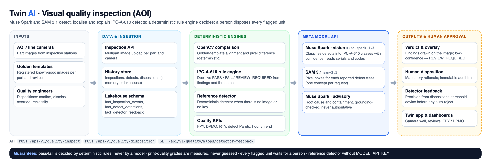

# Visual Quality Inspection: Automated Optical Inspection (AOI) on Meta Model API

An Automated Optical Inspection (AOI) service for electronics and precision manufacturing lines (IPC-A-610 Class 2). **Meta's Muse Spark and SAM 3.1** detect, localise and explain defects; a **deterministic rule engine** decides the verdict; a **person** disposes every flagged unit.



---

## 1. Architecture overview

```
Industrial cameras (AOI / GigE / thermal / CCTV)
       │  part image
       ▼
FastAPI backend (Python 3.12+)  POST /api/v1/quality/inspect
  ├── 1. Muse Spark (vision): serial / barcode / DataMatrix payload read (no invented print grade)
  ├── 2. OpenCV: golden-template alignment & pixel difference (deterministic)
  ├── 3. Muse Spark (vision): IPC-A-610 Class 2 defect classification, with confidence
  │      └─ SAM 3.1: pixel boxes for each defect class (one concept per request)
  ├── 4. Deterministic IPC-A-610 rule engine: decisive PASS / FAIL / REVIEW_REQUIRED
  └── 5. Muse Spark: advisory root cause & containment (grounding-checked, never authoritative)
       │
       ├──► Inspection history & human disposition audit trail
       ├──► Detector feedback: precision measured from human dispositions
       └──► Twin web app / Streamlit: FPY, DPMO, Pareto, camera overlays
```

Without `MODEL_API_KEY` (or without an image) the **local reference detector** runs instead, so the pipeline, rule engine and dashboards stay testable offline.

---

## 2. Component choices

| Function | Component | Why |
|---|---|---|
| **Defect classification** | **Muse Spark** (`muse-spark-1.3`, image input, JSON schema output) | Reads the board like an inspector against a fixed IPC-A-610 class list; no per-defect training data needed to start. |
| **Defect localisation** | **SAM 3.1** (`sam-3.1`) | Promptable segmentation gives pixel boxes for each class Muse Spark reports, so findings can be drawn and audited. |
| **Advisory reasoning** | **Muse Spark** | Root-cause and containment text; every figure is checked against the findings, and it is never the pass/fail authority. |
| **Serial / barcode reading** | **Muse Spark** | Reads printed serials and code payloads; print-quality grades (ISO/IEC 15416) come from measurement in the vision service, never from a model. |
| **Golden-template comparison** | **OpenCV** | Alignment and pixel subtraction must be deterministic and repeatable. |
| **Verdict** | **Deterministic rule engine** | Confidence thresholds and IPC-A-610 rules; low-confidence or un-localised findings go to `REVIEW_REQUIRED`. |
| **Model governance** | **Human dispositions** | Confirm / dismiss / override decisions measure detector precision (`/quality/mlops/detector-feedback`) before any threshold is tuned. |
| **Storage & analytics** | SQLite (`vq_` tables) + DuckDB reports | Inspection events, defects, KPIs and the disposition audit trail ([data model](../../../docs/data-model.md)). |

---

## 3. IPC-A-610 Class 2 Standards & Defect Taxonomy

The deterministic rule engine evaluates defects against IPC-A-610 Class 2 (Dedicated Service Electronic Products):

| Defect Class | IPC-A-610 Section | Class 2 Acceptability Threshold | Severity |
|---|---|---|---|
| `SOLDER_BRIDGE` | Section 7.3.5 | Zero bridge allowance between non-common conductors. | CRITICAL |
| `TOMBSTONING` | Section 8.3.2 | Component end-cap lift angle > 15° or termination separation. | HIGH |
| `COMPONENT_MISALIGNMENT` | Section 8.3.1 | Component overhang > 50% of component termination width. | MEDIUM |
| `MISSING_PART` | Section 8.3.12 | 100% presence required for all BOM components. | CRITICAL |
| `LIFTED_LEAD` | Section 8.3.5 | Coplanarity deviation > 0.05 mm above solder land. | HIGH |
| `SOLDER_BALLS` | Section 5.2.7 | Solder balls within 0.13 mm of traces or > 0.1 mm diameter. | MEDIUM |
| `POLARITY_ERROR` | Section 8.3.11 | Diodes, polarized capacitors, IC pin 1 oriented incorrectly. | CRITICAL |
| `INSUFFICIENT_SOLDER` | Section 7.3.3 | Fillet height < 50% of lead height or non-wetting. | HIGH |

---

## 4. Mathematical Quality Formulations

### A. First-Pass Yield (FPY)
The percentage of units that pass inspection on the first run without requiring manual rework or re-inspection:
$$\text{FPY} = \frac{\text{Total units passed on first run}}{\text{Total units inspected}} \times 100\%$$

### B. Defects Per Million Opportunities (DPMO)
Standard six-sigma defect metric accounting for complexity:
$$\text{DPMO} = \frac{\text{Total defects detected}}{\text{Total inspected units} \times \text{Defect opportunities per unit}} \times 10^6$$

### C. Rolled Throughput Yield (RTY)
Probability that a unit passes all $m$ sequential inspection stages without defects:
$$\text{RTY} = \prod_{k=1}^m \text{FPY}_k$$

---

## 5. Auditable Human Review Dispositions

To guarantee regulatory compliance, quality engineers review flagged units through an auditable disposition workflow:
1. **Automated Optical Assessment**: Muse Spark + SAM 3.1 and OpenCV flag anomalies; the rule engine sets `FAIL` or `REVIEW_REQUIRED`.
2. **Advisory Synthesis**: Muse Spark proposes probable root causes and containment actions (grounded, advisory).
3. **Human Disposition**: Certified auditors confirm, dismiss, or reclassify the defect with mandatory compliance rationale:
   - `CONFIRM_DEFECT`: Upholds defect; triggers rework ticket in CMMS.
   - `DISMISS_DEFECT`: Overrides defect if within acceptable visual variance; logs auditor ID.
   - `OVERRIDE_PASS`: Releases unit with justification.
   - `RECLASSIFY`: Corrects the defect class; feeds the detector feedback metrics.
4. **Audit Trail**: Every disposition is recorded (in SQLite) and drives detector precision.

---

## 6. REST API Reference

The router is mounted at `/api/v1/quality` in [`backend/main.py`](../../main.py).

| Method | Endpoint | Description |
|---|---|---|
| `POST` | `/quality/inspect` | Multipart image inspection: Muse Spark + SAM 3.1 defects, Muse Spark serial read, OpenCV golden comparison, deterministic verdict, advisory. |
| `GET` | `/quality/summary/{line_id}` | Real-time First-Pass Yield (FPY), DPMO, and defect distribution. |
| `GET` | `/quality/pareto` | Defect Pareto breakdown categorized by IPC-A-610 Class 2 clauses. |
| `POST` | `/quality/templates/register` | Registers a verified golden template. |
| `GET` | `/quality/templates/{part_number}` | Retrieves active golden template metadata. |
| `POST` | `/quality/disposition` | Records auditable human disposition (confirm/dismiss/override) with compliance rationale. |
| `GET` | `/quality/audit/dispositions` | Retrieves chronological human review audit log. |
| `GET` | `/quality/mlops/detector-feedback` | Detector precision from human dispositions, with a threshold-tuning recommendation. |
| `GET` | `/quality/config` | Retrieves active similarity and FPY thresholds. |
| `PUT` | `/quality/config` | Updates quality thresholds at runtime. |

---

## 7. Running it

```bash
export PYTHONPATH=.
cp backend/.env.example backend/.env      # set MODEL_API_KEY to turn on Muse Spark + SAM 3.1
uvicorn backend.main:app --host 0.0.0.0 --port 8000 --reload
curl -F image=@board.png "localhost:8000/api/v1/quality/inspect?part_id=PART-ECU-REV-B-001"
```

Without a key every step is deterministic (reference detector, simulated serial read, template advisory). `GET /ai/status` shows which Meta models are active and the latest calls.
