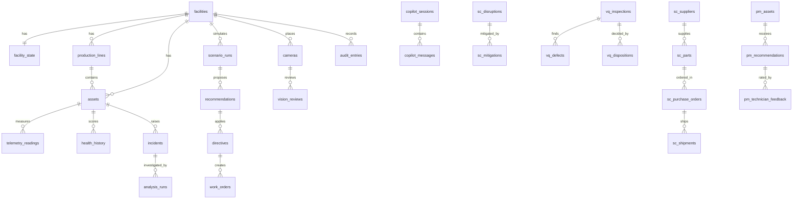

# Twin data model (SQLite)

Generated by `docs/architecture/src/build_data_model.py` from a live database. **83 tables** in one SQLite file
(`.data/twin.db`, or `TWIN_DB_PATH` / `TWIN_DATA_DIR`), shared by the Next.js web app (component `web`) and the Python
intelligence backend (component `backend`). Each component owns and migrates its tables; `schema_migrations` records both.

## Design

- **System of record, not a cache.** Every API endpoint of both components reads and writes these tables; the UI keeps no
  state of its own except an offline copy of the browser's preferences (synced to `client_preferences`).
- **Typed columns + JSON payload.** Each entity table has its natural key, typed and indexed columns that queries filter on
  (status, asset, line, plant, timestamps), its position (`ord`) and the full entity as JSON (`data`), so the domain code
  round-trips exactly while the data stays relational and queryable.
- **Change-only writes.** The web app's twin is written row by row: a live tick updates the handful of rows that changed in
  one transaction. The backend writes each change through as it happens (`PersistentDict` / `PersistentList`).
- **Concurrency.** WAL journal mode lets both processes read while one writes; `busy_timeout` absorbs short write locks.
- **Auditability.** Settings and configuration changes keep full history; every Meta Model API call and every AI-written
  answer is logged; human decisions (approvals, dispositions) record who and when.
- **Multi-facility.** Web tables are keyed by `facility_id` with `ON DELETE CASCADE`, so a twin and all its rows are one unit.

## Web app (component `web`)

### Factory twin, settings, preferences and copilot

| Table | Purpose | Columns |
|---|---|---|
| `active_facility` | Which twin the app shows. | `id` 🔑, `facility_id`, `updated_at` |
| `analysis_runs` | Six-agent analysis runs: stages, findings and the narrative. | `facility_id` 🔑, `id` 🔑, `status`, `incident_id`, `started_at`, `ord`, `data`, `updated_at` |
| `app_settings` | Integration settings set in Admin → Integrations (override environment variables). | `key` 🔑, `value`, `is_secret`, `updated_at`, `updated_by` |
| `app_settings_history` | Every settings change (secret values never stored). | `id` 🔑, `key`, `action`, `value`, `changed_at`, `changed_by` |
| `asset_connections` | Dependencies between assets, inventory and orders. | `facility_id` 🔑, `id` 🔑, `kind`, `source_id`, `target_id`, `ord`, `data`, `updated_at` |
| `assets` | Machines and equipment: archetype, line, status, physics parameters and condition. | `facility_id` 🔑, `id` 🔑, `line_id`, `kind`, `status`, `name`, `ord`, `data`, `updated_at` |
| `audit_entries` | Audit trail: every alert, finding, run, decision, AI call and setting change. | `facility_id` 🔑, `id` 🔑, `at`, `category`, `severity`, `actor`, `title`, `ord`, `data`, `updated_at` |
| `cameras` | Cameras placed in the twin and their stream source. | `facility_id` 🔑, `id` 🔑, `kind`, `line_id`, `asset_id`, `stream_kind`, `ord`, `data`, `updated_at` |
| `client_preferences` | Per-browser preferences and drafts (UI layout, simulator workbench, builder / playground drafts, copilot view, theme). | `client_id` 🔑, `namespace` 🔑, `value`, `version`, `updated_at` |
| `copilot_evidence` | Tool results a conversation's answers are grounding-checked against. | `session_id` 🔑, `seq` 🔑, `data` |
| `copilot_messages` | Copilot messages as the model saw them (text, tool calls, tool results). | `session_id` 🔑, `seq` 🔑, `role`, `parts`, `created_at` |
| `copilot_sessions` | Copilot conversations (model, pending confirmation). | `id` 🔑, `client_id`, `facility_id`, `model`, `pending_confirmation`, `created_at`, `updated_at` |
| `customer_orders` | Customer orders with due time, quantity and penalties. | `facility_id` 🔑, `id` 🔑, `product_id`, `due_hour`, `priority`, `ord`, `data`, `updated_at` |
| `data_connections` | Planned data connections (OPC UA, MQTT, Pub/Sub, cameras…). | `facility_id` 🔑, `id` 🔑, `target`, `kind`, `status`, `ord`, `data`, `updated_at` |
| `directives` | Operating directives applied to the twin (speed, reroute, maintenance windows). | `facility_id` 🔑, `id` 🔑, `asset_id`, `status`, `kind`, `ord`, `data`, `updated_at` |
| `facilities` | One row per digital twin (plant): profile, schema version, demo flag. | `id` 🔑, `name`, `industry`, `location`, `production_type`, `data_source`, `is_demo`, `schema_version`, `seed`, `created_at`, `updated_at` |
| `facility_state` | Singleton parts of a twin: simulation clock, cost model, counters, latest readings, layout, Twin Builder spec. | `facility_id` 🔑, `clock`, `cost_model`, `counters`, `finished_goods`, `latest`, `rule_runtime`, `layout`, `twin_spec`, `sim_hour`, `live_telemetry`, `updated_at` |
| `health_history` | Daily health score per asset. | `facility_id` 🔑, `asset_id` 🔑, `day` 🔑, `score`, `ord`, `data`, `updated_at` |
| `incidents` | Incidents raised from anomalies and their lifecycle. | `facility_id` 🔑, `id` 🔑, `asset_id`, `severity`, `status`, `opened_hour`, `ord`, `data`, `updated_at` |
| `inventory_items` | Components, packaging and raw materials with stock and inbound POs. | `facility_id` 🔑, `id` 🔑, `name`, `category`, `ord`, `data`, `updated_at` |
| `maintenance_records` | Historical maintenance on each asset. | `facility_id` 🔑, `id` 🔑, `asset_id`, `type`, `hour`, `cost`, `ord`, `data`, `updated_at` |
| `mobile_robots` | Mobile robot fleets (AMR / AGV / forklift / tugger). | `facility_id` 🔑, `id` 🔑, `fleet_id`, `line_id`, `robot_type`, `ord`, `data`, `updated_at` |
| `plant_rules` | Automation rules from the Playground (inventory, maintenance, connector). | `facility_id` 🔑, `id` 🔑, `kind`, `enabled`, `name`, `ord`, `data`, `updated_at` |
| `production_hours` | Hourly production per line (output, scrap by cause, downtime, energy). | `facility_id` 🔑, `line_id` 🔑, `hour` 🔑, `good_units`, `scrap_units`, `run_hours`, `energy_kwh`, `ord`, `data`, `updated_at` |
| `production_lines` | Production lines (assembly / packaging) of the plant. | `facility_id` 🔑, `id` 🔑, `name`, `kind`, `ord`, `data`, `updated_at` |
| `products` | Products with BOM and routing. | `facility_id` 🔑, `id` 🔑, `name`, `ord`, `data`, `updated_at` |
| `recommendations` | Plans awaiting or after human approval (approve / reject / rollback). | `facility_id` 🔑, `id` 🔑, `at`, `status`, `scenario_id`, `decided_by`, `ord`, `data`, `updated_at` |
| `scenario_runs` | What-if simulation runs with all scenario results. | `facility_id` 🔑, `id` 🔑, `at`, `target_asset_id`, `recommended_id`, `ord`, `data`, `updated_at` |
| `telemetry_readings` | Measured telemetry per asset (vibration mm/s, °C, kW, speed %, throughput, running). | `facility_id` 🔑, `asset_id` 🔑, `t` 🔑, `vibration`, `temperature`, `power_kw`, `speed_pct`, `throughput`, `running`, `ord`, `data`, `updated_at` |
| `vision_reviews` | Visual reviews (AI, OpenCV, station log) with their human disposition. | `facility_id` 🔑, `id` 🔑, `at`, `camera_id`, `source`, `disposition`, `model`, `ord`, `data`, `updated_at` |
| `work_orders` | Maintenance work orders created by approved plans. | `facility_id` 🔑, `id` 🔑, `asset_id`, `status`, `ord`, `data`, `updated_at` |

## Intelligence backend (component `backend`)

### Demand forecasting

| Table | Purpose | Columns |
|---|---|---|
| `df_demand_history` | Daily actual demand per product and plant. | `key` 🔑, `product_id`, `plant_id`, `recorded_at`, `actual_units`, `ord`, `data`, `updated_at` |
| `df_downtime_events` | Planned and unplanned downtime events. | `key` 🔑, `asset_id`, `plant_id`, `ord`, `data`, `updated_at` |
| `df_equipment_assets` | Equipment health and availability for capacity planning. | `key` 🔑, `plant_id`, `ord`, `data`, `updated_at` |
| `df_ingest_batches` | Ingestion batch results (received, validated, quarantined, duplicates). | `key` 🔑, `target_table`, `status`, `ingested_at`, `ord`, `data`, `updated_at` |
| `df_inventory_positions` | Inventory positions: on hand, safety stock, ROP, stock-out ETA. | `key` 🔑, `plant_id`, `category`, `days_on_hand`, `ord`, `data`, `updated_at` |
| `df_model_registry` | Forecast model registry with validation metrics. | `key` 🔑, `model_type`, `ord`, `data`, `updated_at` |
| `df_pipeline_runs` | Data pipeline run status. | `key` 🔑, `status`, `ord`, `data`, `updated_at` |
| `df_plants` | Plant master data. | `key` 🔑, `ord`, `data`, `updated_at` |
| `df_production_lines` | Line master: capacity, shifts, products. | `key` 🔑, `plant_id`, `ord`, `data`, `updated_at` |
| `df_products` | Product master: family, price, cost, lead times. | `key` 🔑, `ord`, `data`, `updated_at` |
| `df_quality_summaries` | Quality KPIs per plant / product. | `key` 🔑, `ord`, `data`, `updated_at` |
| `df_quality_trends` | Daily FPY and scrap trend. | `key` 🔑, `plant_id`, `ord`, `data`, `updated_at` |
| `df_quarantine` | Quarantined ingestion records with the reason. | `key` 🔑, `reason_kind`, `ord`, `data`, `updated_at` |
| `df_replenishment_recommendations` | Replenishment recommendations (quantity, supplier, urgency). | `key` 🔑, `item_id`, `urgency`, `ord`, `data`, `updated_at` |
| `df_sales_orders` | Open sales orders. | `key` 🔑, `product_id`, `plant_id`, `ord`, `data`, `updated_at` |

### Predictive maintenance

| Table | Purpose | Columns |
|---|---|---|
| `pm_approved_procedures` | Governed, approved SOPs used by the copilot. | `key` 🔑, `equipment_type`, `version`, `ord`, `data`, `updated_at` |
| `pm_assets` | Canonical enterprise asset catalogue (plant, line, criticality, downtime cost). | `key` 🔑, `plant_id`, `line_id`, `equipment_type`, `criticality`, `hourly_downtime_cost_usd`, `ord`, `data`, `updated_at` |
| `pm_historical_incidents` | RAG knowledge base: historical failures with root cause and verified outcome. | `key` 🔑, `asset_id`, `equipment_type`, `failure_code`, `ord`, `data`, `updated_at` |
| `pm_predictions` | Latest 24 h failure-risk prediction per machine. | `key` 🔑, `failure_probability`, `risk_category`, `predicted_at`, `ord`, `data`, `updated_at` |
| `pm_recommendations` | Prescriptive maintenance recommendations and their human approval. | `key` 🔑, `asset_id`, `approval_status`, `approved_by`, `created_at`, `ord`, `data`, `updated_at` |
| `pm_roi_ledger` | Financial ledger of estimated and realised maintenance value. | `key` 🔑, `asset_id`, `recorded_at`, `value_category`, `ord`, `data`, `updated_at` |
| `pm_sensor_readings` | Machine telemetry: vibration RMS, temperature, pressure, RPM, operating hours. | `group_key` 🔑, `key` 🔑, `reading_at`, `vibration_mm_s`, `temperature_c`, `pressure_bar`, `rpm`, `plant_id`, `ord`, `data`, `updated_at` |
| `pm_source_mappings` | Source-system tag → canonical asset id (PLC, SCADA, CMMS, ERP). | `key` 🔑, `canonical_asset_id`, `ord`, `data`, `updated_at` |
| `pm_technician_feedback` | Technician feedback on recommendations (rating, decision, outcome). | `key` 🔑, `recommendation_id`, `asset_id`, `decision`, `usefulness_rating`, `ord`, `data`, `updated_at` |

### Supply chain intelligence

| Table | Purpose | Columns |
|---|---|---|
| `sc_alternative_contracts` | Pre-negotiated alternative supplier contracts. | `key` 🔑, `part_id`, `ord`, `data`, `updated_at` |
| `sc_bill_of_materials` | Bill of materials: parts per finished assembly. | `key` 🔑, `finished_assembly_id`, `part_id`, `ord`, `data`, `updated_at` |
| `sc_carriers` | Carriers and on-time performance. | `key` 🔑, `ord`, `data`, `updated_at` |
| `sc_customer_orders` | Customer orders, revenue and status. | `key` 🔑, `plant_id`, `order_status`, `revenue_usd`, `ord`, `data`, `updated_at` |
| `sc_demand_forecasts` | Demand forecasts per assembly. | `key` 🔑, `assembly_id`, `ord`, `data`, `updated_at` |
| `sc_disruptions` | Supply disruption events. | `key` 🔑, `severity`, `resolved_flag`, `ord`, `data`, `updated_at` |
| `sc_excess_inventory` | Excess / obsolescence-risk inventory. | `key` 🔑, `ord`, `data`, `updated_at` |
| `sc_inventory_balances` | Stock per part, warehouse and plant with stock-out risk. | `key` 🔑, `part_id`, `plant_id`, `warehouse_id`, `stockout_risk_score`, `ord`, `data`, `updated_at` |
| `sc_mitigations` | Mitigation recommendations and their approval. | `key` 🔑, `disruption_id`, `status`, `approved_by`, `ord`, `data`, `updated_at` |
| `sc_parts` | Parts with primary / alternate supplier and cost. | `key` 🔑, `primary_supplier_id`, `unit_cost_usd`, `ord`, `data`, `updated_at` |
| `sc_plants` | Plants and their daily production targets. | `key` 🔑, `country`, `ord`, `data`, `updated_at` |
| `sc_production_schedules` | Production schedules per line and assembly. | `key` 🔑, `plant_id`, `line_id`, `ord`, `data`, `updated_at` |
| `sc_purchase_orders` | Purchase orders and their status. | `key` 🔑, `supplier_id`, `part_id`, `po_status`, `ord`, `data`, `updated_at` |
| `sc_shipments` | Inbound shipments by carrier and status. | `key` 🔑, `po_id`, `status`, `ord`, `data`, `updated_at` |
| `sc_suppliers` | Suppliers with tier, category and composite risk. | `key` 🔑, `country`, `category`, `risk_level`, `ord`, `data`, `updated_at` |
| `sc_warehouses` | Warehouses, capacity and utilisation. | `key` 🔑, `associated_plant_id`, `ord`, `data`, `updated_at` |
| `sc_what_if_runs` | What-if disruption simulations with the Muse Wonder briefing. | `key` 🔑, `subject_id`, `created_at`, `ord`, `data`, `updated_at` |

### Visual quality inspection

| Table | Purpose | Columns |
|---|---|---|
| `vq_defects` | One row per detected defect (class, confidence, severity, IPC clause, box, source). | `key` 🔑, `inspection_id`, `defect_class`, `confidence`, `severity`, `source_kind`, `ipc_clause`, `ord`, `data`, `updated_at` |
| `vq_dispositions` | Immutable human disposition audit trail (confirm / dismiss / override / reclassify). | `key` 🔑, `inspection_id`, `auditor_id`, `action`, `final_verdict`, `decided_at`, `ord`, `data`, `updated_at` |
| `vq_golden_templates` | Registered golden reference templates per part number and revision. | `key` 🔑, `template_id`, `revision`, `registered_by`, `ord`, `data`, `updated_at` |
| `vq_inspections` | AOI inspection events: verdict, detector, similarity, serial read, advisory, latency. | `key` 🔑, `camera_id`, `part_id`, `line_id`, `inspected_at`, `verdict`, `detector_name`, `similarity`, `defects_count`, `disposition_status`, `ord`, `data`, `updated_at` |

## Shared platform tables

### Migrations, AI activity and configuration

| Table | Purpose | Columns |
|---|---|---|
| `ai_calls` | Every Meta Model API call from either component (model, purpose, ok, latency). | `id` 🔑, `component`, `model`, `purpose`, `ok`, `latency_ms`, `detail`, `created_at` |
| `ai_interactions` | AI-written answers from the backend with their grounding status. | `id` 🔑, `feature`, `subject_id`, `question`, `language`, `generated_by`, `note`, `answer`, `created_at` |
| `app_config` | Backend feature configurations (current). | `component` 🔑, `data`, `version`, `updated_at`, `updated_by` |
| `app_config_history` | Every backend configuration change. | `id` 🔑, `component`, `data`, `changed_at`, `changed_by` |
| `schema_migrations` | Applied migrations per component (web, backend). | `component` 🔑, `version` 🔑, `name`, `applied_at` |

## API → table map (writes)

| Endpoint | Tables written |
|---|---|
| Every web mutation (`/api/telemetry/*`, `/api/faults`, `/api/agents/analyze`, `/api/scenarios`, `/api/recommendations/*`, `/api/assets/*`, `/api/cameras/*`, `/api/vision/*`, `/api/builder/build`, `/api/factory*`, `/api/demo/crisis`) | the facility's entity tables (change-only), `facility_state`, `audit_entries` |
| `PUT /api/integrations/settings` | `app_settings`, `app_settings_history` |
| `PUT/DELETE /api/prefs/:namespace` | `client_preferences` |
| `POST /api/copilot` | `copilot_sessions`, `copilot_messages`, `copilot_evidence`, `ai_calls` |
| Any Meta Model API call (web or backend) | `ai_calls` |
| `POST /api/v1/maintenance/recommendations/:id/approve|reject` | `pm_recommendations` |
| `POST /api/v1/maintenance/copilot/chat` · `/copilot/feedback` | `ai_interactions` · `pm_technician_feedback`, `pm_roi_ledger` |
| `POST /api/v1/quality/inspect` · `/disposition` · `/templates/register` | `vq_inspections`, `vq_defects` · `vq_dispositions`, `vq_inspections` · `vq_golden_templates` |
| `POST /api/v1/supply-chain/mitigations/:id/approve` | `sc_mitigations`, `sc_disruptions` |
| `POST /api/v1/supply-chain/assistant/what-if` · `/simulation/run` · `/impact/trace/:id` · `/recommend-po/:part` | `sc_what_if_runs` · `sc_simulation_runs` · `sc_impact_traces` · `sc_po_recommendations` |
| `POST /api/v1/forecasts/run` · `/scenarios/simulate` · `/data/ingest` · `/production/plan/generate` · `GET /production/brief` | `df_forecast_runs` · `df_scenarios` · `df_demand_history`, `df_quarantine`, `df_ingest_batches` · `df_production_plans` · `df_planning_briefs` |
| `GET /api/v1/copilot/shift-handover/:line` · `/alarm-triage/:asset/:code` | `oc_shift_handovers` · `oc_alarm_triages` |
| `PUT /api/v1/*/config` (7 features) | `app_config`, `app_config_history` |
